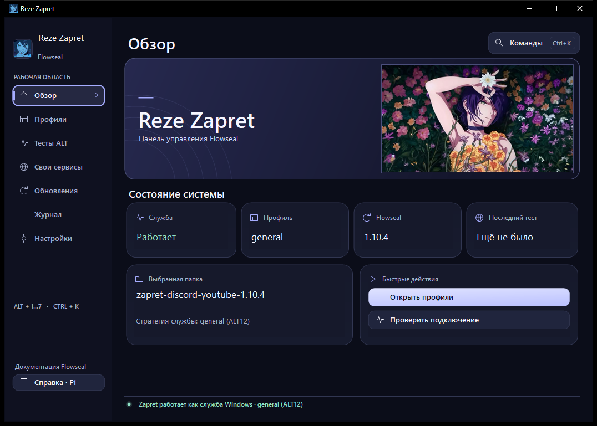

# Reze Zapret

<p align="center">
  
</p>

<p align="center">
  <strong>Удобная панель управления Flowseal для Windows</strong><br>
  Профили, свои домены, проверка подключения, обновления и журнал в одном окне.
</p>

<p align="center">
  
  
  
</p>

> [!WARNING]
> **Reze Zapret находится в стадии бета-тестирования.** Проект активно дорабатывается. В следующих версиях интерфейс, настройки и отдельные функции могут изменяться. Перед обновлением сохраняйте важные списки доменов и переносимые настройки.

## О проекте

Reze Zapret — графическая оболочка для управления распакованной сборкой [Flowseal zapret-discord-youtube](https://github.com/Flowseal/zapret-discord-youtube).

Приложение помогает выбрать профиль, запустить его через штатный механизм Flowseal, редактировать пользовательские списки доменов, проверить доступность сайтов, посмотреть историю действий и подготовить обновление сборки.

Reze Zapret не заменяет штатные файлы Flowseal и не переключает службу Windows автоматически. Изменение службы выполняется пользователем через штатное меню Flowseal.

## Содержание

- [Возможности](#возможности)
- [Скриншоты](#скриншоты)
- [Что нужно для работы](#что-нужно-для-работы)
- [Установка](#установка)
- [Первый запуск](#первый-запуск)
- [Профили](#профили)
- [Свои домены](#свои-домены)
- [Проверка домена](#проверка-домена)
- [ALT-лаборатория](#alt-лаборатория)
- [Журнал действий](#журнал-действий)
- [Обновления и откат](#обновления-и-откат)
- [Трей и быстрые действия](#трей-и-быстрые-действия)
- [Настройки и перенос](#настройки-и-перенос)
- [Горячие клавиши](#горячие-клавиши)
- [Решение проблем](#решение-проблем)
- [Статус бета-версии и планы](#статус-бета-версии-и-планы)
- [Ошибки, комментарии и предложения](#ошибки-комментарии-и-предложения)
- [Поддержка проекта](#поддержка-проекта)
- [Сборка из исходников](#сборка-из-исходников)
- [Связанные проекты](#связанные-проекты)

## Возможности

### Рабочая область

- Холодная сине-индиговая цветовая схема.
- Минимальный размер окна 900×680.
- Главная панель с состоянием службы, профиля, сборки Flowseal и последнего теста.
- Быстрые действия для перехода к профилям и проверке подключения.
- Собственные полосы прокрутки для списков, многострочного текста и масштаба.
- Подсказки для кнопок, путей и состояний.

### Профили

- Поиск профилей по имени.
- Фильтрация по тегам через `#тег`.
- Избранные профили и отдельный фильтр избранного.
- Отображение тегов рядом с профилем.
- Проверка профиля перед запуском.
- Сравнение выбранного профиля с последним рабочим профилем.
- Сохранение последнего профиля, который действительно запустил `winws.exe`.
- Запуск и остановка через существующий механизм `Session`.
- Запуск с запросом прав администратора, если они необходимы.

### Свои домены

- Отдельные списки включений и исключений.
- Нормализация доменов и адресов HTTP/HTTPS.
- Поддержка IDN-доменов с преобразованием в ASCII-форму.
- Поиск по сохранённым доменам.
- Добавление, удаление и копирование выбранных записей.
- Импорт из TXT, CSV и буфера обмена.
- Предпросмотр импорта до записи в файл.
- История изменений списков.
- Возврат последнего изменения и восстановление резервной копии.

### ALT-лаборатория

- Проверка текущего подключения.
- Наборы сайтов для проверки.
- Добавление собственных сайтов.
- Быстрый режим с одной попыткой.
- Подробный режим с тремя повторениями.
- Измерение DNS, TCP, TLS и HTTP.
- Прогресс текущей проверки.
- Фильтр успешных результатов и результатов с ошибками.
- Сортировка результатов по сайтам.
- Просмотр отдельных попыток.
- История запусков до 20 записей.
- Сравнение сохранённых запусков.
- Экспорт результатов в CSV.
- Запуск профиля из строки результата.
- Отмена длительной проверки.
- Уведомление о завершении проверки через трей.

### Журнал

- Постоянное хранение до 600 последних записей.
- Поиск по журналу без изменения сохранённых данных.
- Экспорт текущего отображения в TXT.
- Копирование в буфер обмена.
- Очистка журнала с удалением сохранённой истории.
- Записи о запуске профиля, доменах, ALT, обновлениях и импорте настроек.

### Обновления Flowseal

- Проверка стабильного релиза Flowseal через GitHub API.
- Проверка SHA-256 загружаемого ZIP.
- Подготовка отдельной локальной папки.
- Перенос пользовательских списков в подготовленную сборку.
- Список доступных локальных сборок.
- История использованных папок между запусками приложения.
- Проверка целостности выбранной старой сборки.
- Откат Reze на предыдущую локальную сборку.
- Отмена операции загрузки.
- Автоматическая проверка при запуске и далее каждые шесть часов.

Откат изменяет выбранную папку Reze. Работающая служба Windows продолжает использовать свою текущую папку до тех пор, пока пользователь не переключит её через штатное меню Flowseal.

### Настройки

- Масштаб интерфейса от 80 до 140 процентов.
- Компактная, обычная и просторная плотность интерфейса.
- Акценты «Лёд», «Лаванда» и «Мята».
- Компактная шапка.
- Включение и отключение значка в трее.
- Скрытие окна в трей при закрытии.
- Уведомления о завершении ALT.
- Уведомления о новых версиях Flowseal.
- Заметки профилей.
- Теги профилей.
- Экспорт и импорт настроек в JSON.

## Скриншоты

Главный экран показывает состояние службы, выбранного профиля, версии Flowseal и последнего теста.



В репозитории также подготовлена папка со снимками основных разделов интерфейса.

- [Профили](docs/screenshots/profiles.png)
- [Свои домены](docs/screenshots/domains.png)
- [Журнал](docs/screenshots/journal.png)
- [ALT-лаборатория](docs/screenshots/alt.png)
- [Обновления](docs/screenshots/updates.png)
- [Настройки](docs/screenshots/settings.png)

Снимки интерфейса сделаны во время бета-тестирования. В будущих версиях внешний вид может измениться.

## Что нужно для работы

- Windows с поддержкой .NET Framework 4.x.
- Распакованная сборка Flowseal.
- Права администратора для операций, которым они требуются самой сборке Flowseal.
- Доступ к сети для проверки сайтов и загрузки релизов.

Reze Zapret не содержит `winws.exe` и не заменяет сборку Flowseal. Сборку нужно получить из официального репозитория Flowseal и распаковать в отдельную папку.

## Установка

### Вариант для пользователя

1. Откройте раздел [Releases](../../releases).
2. Скачайте последнюю доступную бета-сборку Reze Zapret.
3. Распакуйте приложение в отдельную папку.
4. Скачайте и распакуйте сборку Flowseal из [официального репозитория](https://github.com/Flowseal/zapret-discord-youtube).
5. Запустите `Reze-Zapret.exe`.
6. В разделе «Профили» нажмите «Выбрать папку».
7. Укажите папку, где находятся `service.bat`, `bin\winws.exe` и `lists`.

Не запускайте приложение из папки, которую планируете регулярно заменять при обновлении Flowseal. Для Reze удобнее использовать отдельную постоянную папку.

### Проверка папки Flowseal

Приложение ожидает следующую структуру:

```text
Flowseal/
├── service.bat
├── general.bat
├── general (имя профиля).bat
├── bin/
│   └── winws.exe
└── lists/
    ├── list-general-user.txt
    └── list-exclude-user.txt
```

Названия профилей должны соответствовать формату Flowseal, например `general.bat` или `general (название).bat`.

## Первый запуск

1. Запустите Reze Zapret.
2. Откройте «Профили».
3. Выберите папку распакованной сборки Flowseal.
4. Выберите профиль в списке.
5. Нажмите «Проверить», чтобы проверить профиль без запуска.
6. Нажмите «Запустить».
7. Если Windows запросит повышение прав, подтвердите его для запуска профиля.
8. После обнаружения `winws.exe` приложение сохранит профиль как последний рабочий.
9. Проверить результат можно на панели «Обзор» или в разделе «Тесты ALT».

Если запущена служба `zapret`, кнопка запуска профиля будет недоступна, пока служба не будет остановлена штатным способом.

## Профили

### Поиск и избранное

В поле поиска можно вводить часть имени профиля. Для фильтрации по тегу используйте запись вроде `#видео`.

Кнопка «Избранные» оставляет в списке только закреплённые профили. Закрепление сохраняется в настройках приложения.

### Заметки и теги

Откройте раздел «Настройки» и нажмите «Заметки профилей».

- Заметка хранит произвольный текст.
- Теги вводятся через пробел, например `#видео #игры`.
- Допустимы буквы, цифры, дефис и подчёркивание.
- Регистр тегов нормализуется.
- Для одного профиля сохраняется до восьми тегов.

### Проверка профиля

Проверка выполняется без запуска BAT-файла. Она проверяет папку Flowseal, допустимое имя профиля, существование файла, размер файла и наличие запуска `winws` в содержимом.

### Сравнение с последним рабочим профилем

Кнопка «Сравнить с рабочим» показывает различия между выбранным профилем и профилем, который последним успешно обнаружил работающий `winws.exe`.

## Свои домены

Раздел «Свои сервисы» работает с пользовательскими списками Flowseal.

### Добавление доменов

1. Выберите «Включения» или «Исключения».
2. Введите домен или полный адрес сайта по одному на строку.
3. Проверьте предпросмотр нормализованных значений.
4. Нажмите «Добавить».
5. Если адрес уже есть в другом списке, приложение покажет предупреждение.

Поддерживаются записи вроде:

```text
example.org
https://example.org/path
Пример.рф
```

В список попадёт домен без пути и протокола.

### Импорт

Импорт из файла и буфера обмена сначала открывает предпросмотр. В нём отображаются добавляемые записи, дубликаты, конфликты и ошибки. Запись выполняется только после нажатия кнопки импорта.

### Откат списков

«История» показывает изменения выбранного списка. Кнопка «Отменить последнее» возвращает состояние до последней операции, если файл с тех пор не был изменён другим способом.

Если профиль был запущен во время изменения списка, в статусе появится отметка о необходимости перезапуска профиля.

## Проверка домена

Введите домен первой непустой строкой в редакторе доменов и нажмите «Проверить домен».

Проверка использует ту же сетевую логику, что и ALT-лаборатория. Она показывает результат DNS, TCP, TLS и HTTP-проверки, а также сохраняет действие в журнале.

Результат может зависеть от DNS-сервера, CDN, блокировок, настройки маршрутизации и ответа самого сайта. Проверка выполняется по HTTPS на стандартном порту.

## ALT-лаборатория

### Быстрая проверка

«Проверить текущее» проверяет текущее состояние подключения без запуска выбранных профилей.

### Сравнение с базой

«Сравнить с базой» сначала измеряет подключение без профиля, затем формирует строки для выбранных профилей. Профиль из строки можно запустить обычным способом и после этого отдельно выполнить проверку текущего подключения.

Текущая бета-версия не запускает все профили автоматически внутри сравнения. Это сделано для сохранения штатного поведения Flowseal и контроля пользователя над запуском профиля.

### Режимы и результаты

- Быстрый режим выполняет одну попытку.
- Подробный режим выполняет три попытки на сайт.
- Прогресс показывает завершённые измерения.
- Фильтр отделяет успешные строки от строк с ошибками.
- Нажатие на заголовок таблицы меняет сортировку.
- Нажатие на ячейку открывает детали попыток.
- История позволяет выбрать старый запуск и сравнить его с текущим.
- CSV сохраняет результаты для дальнейшего анализа.

Для сравнения профилей нужны права администратора, остановленная служба Windows и отсутствие активного сеанса профиля.

## Журнал действий

Журнал доступен в разделе «Журнал».

Он сохраняется в пользовательской папке приложения и содержит до 600 последних записей. Поле поиска фильтрует отображение по тексту. Экспорт сохраняет текущий отфильтрованный вид.

Кнопка «Очистить» удаляет журнал из интерфейса и из постоянного файла.

## Обновления и откат

Откройте раздел «Обновления» и нажмите «Проверить GitHub».

Приложение получает сведения о стабильном релизе Flowseal, проверяет имя и размер ZIP, SHA-256, тип архива и структуру подготовленной папки.

### Подготовка обновления

1. Нажмите «Проверить GitHub».
2. Нажмите «Скачать ZIP».
3. Дождитесь проверки архива и переноса пользовательских списков.
4. Выберите подготовленную сборку в списке локальных версий.
5. Нажмите «Выбрать папку».
6. Перезапустите нужный профиль через раздел «Профили».

### Откат

1. Откройте список локальных сборок.
2. Выберите предыдущую проверенную сборку.
3. Нажмите «Откатить».
4. Подтвердите действие.

Откат меняет папку, которую использует Reze. Служба Windows не переключается автоматически. Это позволяет избежать неожиданного изменения системной конфигурации.

## Трей и быстрые действия

При включённом трее доступны следующие пункты:

- Открыть Reze Zapret.
- Проверить подключение.
- Запустить выбранный профиль.
- Восстановить последний рабочий профиль.
- Завершить работу приложения.

Меню профилей в трее доступно только когда нет активного сеанса, ALT-проверки и работающей службы.

## Настройки и перенос

### Перенос JSON

Экспорт JSON сохраняет:

- параметры интерфейса;
- масштаб, акцент и плотность;
- настройки трея и уведомлений;
- выбранный профиль;
- избранные профили;
- заметки и теги;
- последний рабочий профиль;
- историю локальных папок Flowseal;
- настройки ALT;
- доменные списки, если выбрана папка Flowseal.

Импорт показывает сводку изменений до применения и выполняет откат при ошибке применения.

### Где хранятся данные

Настройки приложения находятся в:

```text
%LocalAppData%\Reze-Zapret\settings.txt
```

История ALT и журнал действий находятся в той же папке `%LocalAppData%\Reze-Zapret`.

Подготовленные локальные сборки Flowseal находятся в:

```text
%LocalAppData%\Reze-Zapret\Flowseal
```

## Горячие клавиши

| Клавиши | Действие |
|---|---|
| `Alt + 1` | Профили |
| `Alt + 2` | Свои сервисы |
| `Alt + 3` | Журнал |
| `Alt + 4` | Тесты ALT |
| `Alt + 5` | Обновления |
| `Alt + 6` | Обзор |
| `Alt + 7` | Настройки |
| `Ctrl + K` | Командная палитра |
| `Ctrl + F` | Поиск в текущем поддерживаемом разделе |
| `F1` | Встроенный гид |
| `Esc` | Закрытие открытого диалога |

## Решение проблем

### Папка не распознаётся

Проверьте, что в выбранной папке есть `service.bat`, `bin\winws.exe` и `lists`. Выбирать нужно распакованную папку, а не ZIP-файл и не вложенную папку `bin`.

### Профиль не запускается

Проверьте профиль кнопкой «Проверить». Затем убедитесь, что:

- служба `zapret` остановлена;
- другой `winws.exe` не работает;
- приложение запущено с нужными правами;
- выбранная папка Flowseal доступна;
- профиль соответствует формату `general.bat` или `general (название).bat`.

### Сравнение ALT недоступно

Для сравнения профилей нужны права администратора, остановленная служба и отсутствие активного сеанса Reze. Также нужно выбрать до пяти профилей и добавить хотя бы один публичный сайт в «Мои сайты».

### Домен не добавляется

Введите домен без пробелов и без IP-адреса. Поддерживаются доменные имена и HTTP/HTTPS-ссылки. Проверьте строку ошибки в предпросмотре.

### Обновление не загружается

Проверьте доступ к GitHub, свободное место и права записи в `%LocalAppData%\Reze-Zapret\Flowseal`. Ошибки загрузки сохраняются в журнале.

### Служба не изменилась после отката

Это ожидаемое поведение. Откат меняет папку Reze, но служба Windows продолжает использовать собственную папку. Переключите службу через штатное меню Flowseal, если это требуется.

## Статус бета-версии и планы

Reze Zapret сейчас находится в бета-версии. Проект будет дорабатываться по отзывам пользователей.

В ближайших версиях планируется улучшать:

- визуальные состояния и уведомления;
- диагностику запуска профилей;
- фильтры результатов ALT;
- сценарии обновления и отката;
- перенос настроек между сборками;
- доступность интерфейса;
- документацию и примеры.

Бета-версия может содержать ошибки, а отдельные функции могут менять внешний вид и поведение. При сообщении об ошибке укажите версию приложения, версию Flowseal, раздел интерфейса и последовательность действий.

## Ошибки, комментарии и предложения

Для обсуждения проекта используйте GitHub Issues.

- [Сообщить об ошибке](../../issues/new?template=bug_report.md)
- [Предложить функцию](../../issues/new?template=feature_request.md)
- [Оставить комментарий или вопрос](../../issues/new?template=general_feedback.md)

Перед созданием обращения проверьте существующие Issues и приложите журнал или скриншот, если они помогают понять проблему. Не публикуйте приватные данные, токены и содержимое, которое не предназначено для открытого доступа.

## Поддержка проекта

Если Reze Zapret оказался полезен, проект можно поддержать через DonationAlerts.

<p align="center">
  <a href="https://www.donationalerts.com/r/povetrie">
    
  </a>
</p>

[Открыть DonationAlerts](https://www.donationalerts.com/r/povetrie)

Поддержка помогает продолжать разработку, тестирование и подготовку новых сборок.

## Сборка из исходников

Для сборки нужен Windows с установленным .NET Framework и компилятором .NET Framework 4.x.

Запустите PowerShell в папке проекта:

```powershell
.\build.ps1 -OutputPath dist\Reze-Zapret.exe
```

Скрипт собирает все `.cs`-файлы из `src`, добавляет встроенную иллюстрацию и иконку приложения.

### Проверка

```powershell
.\tests\check.ps1
```

Проверки покрывают обнаружение сборки Flowseal, работу списков доменов, нормализацию IDN, резервные копии и управление тестовым деревом процессов через `Session`.

## Структура проекта

```text
Reze-Zapret/
├── assets/                 Иллюстрации и иконки
├── docs/                   Скриншоты и документация
├── src/                    Исходный код приложения
│   ├── MainForm*.cs        Экраны и действия интерфейса
│   ├── AltLab.cs           Модели и сетевые проверки ALT
│   ├── DomainHistory.cs    История доменных списков
│   ├── FlowsealRelease.cs  Релизы и локальные сборки Flowseal
│   ├── PortableSettings.cs Перенос настроек
│   ├── ProfileFiles.cs     Профили и домены
│   └── Session.cs          Управление сеансом запуска
├── tests/                  Автоматические проверки
├── build.ps1               Сборка Windows-приложения
└── README.md               Документация проекта
```

## Связанные проекты

- [Flowseal zapret-discord-youtube](https://github.com/Flowseal/zapret-discord-youtube)
- [DonationAlerts Povetrie](https://www.donationalerts.com/r/povetrie)

## Благодарности

Спасибо авторам Flowseal и zapret за основную рабочую сборку, которую Reze Zapret помогает настраивать через графический интерфейс.
